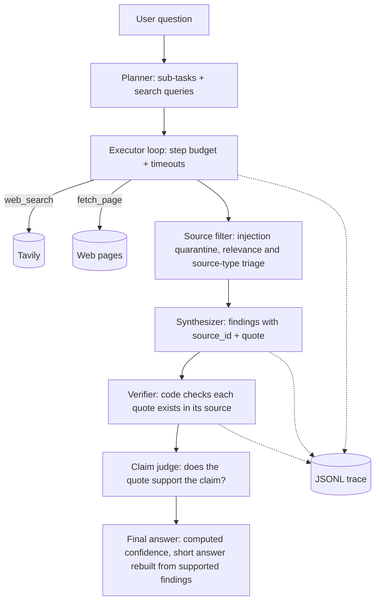

# Evidence-First Research Agent

A production-minded AI research agent. Given a research-style question, it **plans**, **chooses tools**, **gathers and filters sources**, and returns a **schema-validated answer in which every finding is backed by a quote that our code verifies against the fetched source text**. Confidence is computed from evidence signals, not self-reported by the LLM.

> Built as a take-home assignment. The goal is sound engineering judgment on a small, focused system, not a large platform.

## Contents
1. [Quick start](#quick-start)
2. [What it does](#what-it-does)
3. [Architecture](#architecture)
4. [README questions](#answers-to-the-assignment-questions)
5. [Evaluation](#evaluation)
6. [Known limitations](#known-limitations)
7. [Future improvements](#future-improvements)

## Quick start

**Requirements:** Python 3.11+ and API keys for an LLM provider (Groq) and Tavily (search).

```bash
git clone https://github.com/<your-username>/evidence-first-research-agent.git
cd evidence-first-research-agent
python -m venv .venv
# Windows PowerShell: .venv\Scripts\Activate.ps1   |   Mac/Linux: source .venv/bin/activate
pip install -r requirements.txt
cp .env.example .env     # Windows: copy .env.example .env  -> then add your keys
python scripts/check_setup.py   # verifies keys, LLM and search connectivity
```

**Environment variables** (`.env`): `GROQ_API_KEY` and `TAVILY_API_KEY` are required. `LLM_BASE_URL` and `LLM_MODEL` are optional and default to Groq and `openai/gpt-oss-120b`. Model names are configuration, not code, because providers retire models often.

**Run (CLI):**
```bash
python -m app.cli "Compare the top 3 open-source vector databases for a startup building RAG products"
```
**Options:** `--json` prints raw JSON, and `--save samples/out.json` also writes the JSON answer to a file.

**Run (API):**
```bash
uvicorn app.main:app --reload
```
Then open `http://127.0.0.1:8000/docs` and call `POST /research` with `{"question": "..."}`. `GET /health` returns `{"status": "ok"}`.

Every run writes a trace to `traces/<run_id>.jsonl`.

## What it does

Input: a question. Output (JSON, validated by Pydantic):

| Field | Meaning |
|---|---|
| `question` | The user question |
| `short_answer` | 2-4 sentence answer |
| `key_findings` | Claims, each with `source_id`, a verbatim `quote`, a `verified` flag (quote found in the source, set by our code) and a `support` label (`supported` or `partial`, from the judge) |
| `sources` | Sources actually used, with domain, relevance score and flags |
| `confidence` | `high` / `medium` / `low`, computed from evidence signals |
| `confidence_reasons` | Why that level was assigned |
| `limitations` | Assumptions and gaps |
| `next_steps` | Suggested follow-ups |

## Architecture



**Components** (all in `app/`):
- `config.py`: all settings, timeouts and budgets in one place.
- `planner.py`: turns the question into a bounded plan (max 4 sub-tasks, max 2 queries each). Limits are enforced in code, not trusted to the model.
- `executor.py`: runs the plan with the tools under step budgets and per-call timeouts, and logs every tool decision.
- `tools/search.py`, `tools/fetch.py`: the two tools. They never raise; they return a `ToolResult` with `ok`, `data`, `error` and latency.
- `tools/common.py`: shared helpers (site extraction, transient-error classification, prompt-safe escaping).
- `filtering.py`: quarantines pages with prompt-injection patterns, then asks the LLM (one batched call) to label each source's relevance to the success criteria and its type. Our code applies the policy: vendor-marketing and press-release sources are down-weighted, weak ones dropped, and at most 5 kept. If triage fails, sources are kept unscored and a limitation is recorded.
- `synthesizer.py`: asks the LLM for a draft answer from the kept sources only, wrapped as untrusted data. Each finding must carry a source id and a verbatim quote.
- `verifier.py`: normalises text and checks that each finding's quote exists in its source, then computes confidence from evidence signals.
- `judge.py`: a separate LLM call that sees only a finding's claim and quote and labels it supported, partial or unsupported; also rebuilds the short answer from supported findings.
- `agent.py`: the pipeline. It wires every stage together and never raises: any failure becomes a valid low-confidence answer.
- `llm.py`: provider wrapper with explicit timeouts, bounded retries, a client-side tokens-per-minute throttle, JSON-schema validation and one repair attempt on malformed output.
- `cli.py`, `main.py`: command-line and FastAPI (`POST /research`, `GET /health`) entry points.
- `schemas.py`: all data shapes, defined once.
- `tracing.py`: one JSONL line per event.
- `eval/run_failures.py`: failure-injection harness. It patches the tools (not the agent), so the real retry, validation and quarantine code runs. Six scenarios: search down, malformed search payload, all page fetches fail, LLM provider down, obvious prompt injection, and a paraphrased injection that evades our patterns. Results are saved to `eval/failure_results.json`.
- `eval/run_eval.py` and `eval/queries.yaml`: run the evaluation queries through the agent and a single-call LLM baseline, and write a metrics table.


**Stack:** Python, FastAPI, Pydantic v2, OpenAI-compatible SDK (Groq `openai/gpt-oss-120b`), Tavily search, `trafilatura` for page text extraction. No agent framework, on purpose, so the control flow is readable in about 300 lines.

## Answers to the assignment questions

### Why did you choose an agentic approach here?
Research questions need **dynamic retrieval**: the number of searches and which pages to read depends on what earlier steps return, and a weak first search should trigger a refined one. A single prompt cannot do that. At the same time, the workflow is **bounded and mostly deterministic**: plan, gather, filter, synthesize, verify. So the agent only decides *what to search/fetch next*; everything else is fixed code. That limits cost and failure modes. 
The measured comparison is in [`eval/EVALUATION.md`](eval/EVALUATION.md). Where it helped: the agent produced quotes that could be checked against real pages, while the baseline gave no findings in 4 of 5 queries and, when it did cite (q2), none of its quotes were found on the pages. Where it did not help: on the unanswerable query (q4) both systems ended with no findings, and the agent cost about 5x the tokens and 37x the latency.

### What tools did you use, and why?
- **`web_search`** (Tavily): finds candidate sources and returns titles, URLs and snippets.
- **`fetch_page`**: downloads a page and extracts clean text. Snippets alone are too shallow to verify claims against, so evidence is read from the full text.

The planner (LLM) decides *what* to research: 2-4 sub-tasks with search queries. The executor (plain code under hard budgets) decides *where to look*, and logs every decision as a `tool_decision` trace event with its reason:

1. Run up to 2 planner queries per sub-task with `web_search`.
2. If a sub-task yields fewer than 2 unique results, retry once with the sub-task question itself as the query.
3. Rank candidates by search score and read the top pages with `fetch_page`: at most 2 pages per sub-task and 2 per site, skipping duplicates.
4. If no page can be read for a sub-task, fall back to the search snippet, labelled `snippet_only`, and record a note.
5. Budgets per run: 7 searches and 12 page-fetch attempts.

Tool selection is rule-based inside the loop. The LLM does not choose tools mid-run, a deliberate tradeoff for predictability and lower cost.

### How does the system handle bad tool results?
- **Explicit timeouts and bounded retries.** Every network call has a timeout. Retries use exponential backoff and fire only for transient errors (timeouts, connection errors, HTTP 429 and 5xx); a 404 or an unsupported content type fails immediately. The OpenAI SDK's silent retries are disabled so every retry is visible.
- **Validation of tool output.** Search results with a missing or invalid URL or title are skipped. Pages must be HTML or plain text, are capped at 2 MB downloaded and 6000 characters kept, and must yield at least 200 characters of extractable text.
- **Tools never raise.** A failure comes back as `ToolResult(ok=False, error=...)`, so one bad call cannot crash a run.
- **Fallbacks.** A failed page fetch moves on to the next candidate; a thin or failed search retries with the sub-task question as the query. In the Phase 3 test runs, 4 of 10 and 2 of 10 page fetches failed and both runs completed normally.
- **Graceful degradation.** If no page can be read for a sub-task, the executor uses the search snippet, labelled `snippet_only`, and records a note.
- **Budgets.** A run is capped at 7 searches and 12 page-fetch attempts.
- **Insufficient-evidence behaviour.** If no sources are retrieved, none survive filtering, or fewer than 2 findings are judged supported, the answer says "Insufficient verified evidence" instead of guessing. Any other failure inside the pipeline also becomes a valid low-confidence answer.
- **Honest limitations.** Executor problems (a sub-task with no results, snippet-only fallbacks) are added to the final `limitations`.
- **Tested by failure injection.** `eval/run_failures.py` breaks the tools on purpose (search timeouts, malformed payload, every fetch failing, LLM outage). All scenarios passed: the agent never crashed and returned a valid answer with an honest confidence level.

### How do you reduce hallucinations?
1. Sources are filtered before synthesis: pages matching prompt-injection patterns are quarantined, and each source is labelled by relevance and type. Vendor and press-release sources are down-weighted by code, not by the model.
2. The synthesizer sees **only** the kept sources, labelled `S1..Sn` and wrapped as untrusted data.
3. Every finding must carry a `source_id` and a **verbatim quote**.
4. **Our code, not the LLM,** checks that each quote appears in its source, after normalising whitespace, dashes and quotation marks. Quotes under 6 words are rejected. Failing findings are removed.
5. A separate **judge** call sees only a finding's claim and quote (no sources, no question) and labels it `supported`, `partial` or `unsupported`. Unsupported findings are removed; partial ones stay visible but do not count toward confidence. This catches overreach, for example "fastest" backed by a quote that shows one product's numbers.
6. Findings are de-duplicated and capped at 8, taken round-robin across sources so one source cannot domin
ate.
7. Confidence is **computed** from distinct supported quotes, distinct sites and independence from vendor sources, never self-reported. High needs 80%+ supported, 4+ distinct quotes, 3+ sites and 2+ non-vendor sites; medium needs 50%+, 3+ quotes and 2+ sites; otherwise low. If the judge is unavailable, or if any evidence comes from a search snippet instead of a full page, confidence is capped at medium.
8. The short answer is rebuilt from supported findings only. With fewer than 2 supported findings the answer is "Insufficient verified evidence".

**Measured (5 eval queries):** 21 of 21 drafted quotes were found verbatim in their sources, and the judge removed 1 of 6 findings in one query. This checks that quotes are copied faithfully; it does not prove the claims are true. See [`eval/EVALUATION.md`](eval/EVALUATION.md).

### Prompt-injection awareness
Fetched web content is untrusted. It is passed to the LLM inside delimited data blocks with instructions never to follow commands found in content, and our tool layer flags injection-like patterns on the source. Tools are **read-only** (no email, no writes, no code execution), so the blast radius of a successful injection is limited to a degraded answer. Fetching also refuses non-HTTP(S) schemes, `localhost` and private or loopback IP addresses (basic SSRF protection). Pages matching known injection patterns (for example "ignore previous instructions") are quarantined: they are excluded before any LLM call and recorded in the trace. Source text is also escaped so it cannot close the `<source>` tags that wrap it in prompts. Two injection tests are in `eval/run_failures.py`, and the results are not equal:
- **Obvious injection** ("ignore all previous instructions..."): the page was quarantined by the pattern filter, and the planted canary string did not appear in the answer.
- **Paraphrased injection** (no trigger phrases): the pattern filter did **not** catch it (`quarantined=False`). The canary did not appear in the answer in this single run, but that is not evidence of robustness: it depends on the model resisting, and the test was run once. This is why a stronger injection classifier is listed under future improvements.

### How would you make this production-ready?
- Async tool execution and parallel fetches; a real queue and worker for long runs.
- Caching of search and fetch results; rate limiting per user.
- Provider fallback and circuit breakers; secrets management; auth on the API.
- Domain allow/deny lists and a stronger injection classifier.
- Persisted traces in an observability stack (Langfuse or OpenTelemetry) instead of local JSONL files.
- A regression eval suite in CI that runs on every prompt or model change.
- Dockerized deployment on Linux/cloud with health checks.

### What would you monitor in production?
Latency per stage and end to end; tool error and timeout rates; **citation verification rate**; share of `low`-confidence answers; tokens and cost per run; step-budget exhaustion rate; injection-flag rate; provider error and rate-limit rate; user feedback on answer quality.

### What were your key tradeoffs?
| Decision | Chose | Gave up |
|---|---|---|
| Orchestration | Small custom loop | Framework features (retries, graphs) for readability |
| Execution | Synchronous | Speed from parallel fetches |
| Confidence | Computed from evidence | Nuance an LLM judge might capture |
| Verification | Exact quote match | Misses valid paraphrases (tradeoff: false negatives over hallucinations) |
| Scope | One agent, two tools | Breadth (no memory, no multi-agent) |
| Provider | Groq free tier | Possible rate limits |
| Retries | Max 2-4 attempts, transient errors only | Slower recovery from a long provider outage |
| Page text | Capped at 6000 characters per page | Evidence that appears deep in long pages |
| Source filtering | LLM labels sources; code applies penalty and threshold | A fully LLM-judged ranking, which is harder to audit |
| Injection handling | Quarantine (exclude) suspicious pages | Keeping security articles that quote attack phrases (false positives) |
| Claim checking | Exact-quote check in code plus an LLM judge on claim and quote | One extra LLM call per run; the judge can be wrong |
| Rate limits | Client-side throttle (7,000 tokens/minute) after hitting the Groq free-tier limit in testing | Slower runs |
| Findings | Capped at 8, round-robin across sources | Depth from a single rich source |
| Snippet-only evidence | Allowed as a fallback, but confidence capped at medium | Higher confidence from partial evidence |
| Failure testing | Patch the tools, run the real pipeline code | Testing the real network path |

## Evaluation
See [`eval/EVALUATION.md`](eval/EVALUATION.md) for the queries, expected behaviour, and what worked and what did not.

```bash
python -m eval.run_eval          # 5 queries: agent vs single-call baseline -> eval/results_table.md
python -m eval.run_failures      # 6 failure scenarios -> eval/failure_results.json
```

Summary (5 queries, one run each, agent vs single-call LLM baseline):

| Metric | Baseline | Agent |
|---|---|---|
| Quotes found verbatim in a real page | 0 of 5 attempted (it cited sources in only 1 of 5 queries) | 21 of 21 |
| Avg sources cited | 1.0 (URLs from memory) | 1.4 |
| Avg tokens per run | 934 | 9,204 |
| Avg latency (s) | 3.2 | 136.1 |

The agent's check is our own code, so it measures faithful copying, not truth. The agent cost roughly 5 to 15 times the tokens and 20 to 100 times the latency, part of it from the free-tier throttle.

Sample outputs: [`samples/vector_db.json`](samples/vector_db.json), [`samples/collections.json`](samples/collections.json), [`samples/insufficient_evidence.json`](samples/insufficient_evidence.json).

Example traces (one JSON event per line): [`samples/example_traces/q1_vector_db_agent.jsonl`](samples/example_traces/q1_vector_db_agent.jsonl), [`samples/example_traces/injection_obvious.jsonl`](samples/example_traces/injection_obvious.jsonl).

## AI tool usage

I used **Claude (Anthropic)** as a pair-programming and design assistant throughout this assignment, across two chat sessions.

- **Design:** I discussed the assignment and the job description with Claude, then settled on a small custom planner-executor pipeline (no framework) with code-verified quotes, computed confidence and a failure-injection harness.
- **Code:** Claude wrote most of the first drafts of the modules (schemas, tools, LLM wrapper, planner, executor, filtering, synthesizer, verifier, judge, CLI, API, eval scripts), with line-by-line explanations because I am newer to Python.
- **Docs:** Claude drafted the README and `EVALUATION.md`; I applied them section by section and corrected them against real outputs.
- **What I did myself:** set up the environment and API keys, ran every phase and test, debugged real errors (model names, DNS, rate limits), chose between options, and ran the evaluation and failure scenarios. All numbers in the evaluation come from my own runs.

Real run results changed the design several times (for example the Groq rate limit led to the token throttle, and an over-claimed finding led to the claim-support judge). I can explain each module and decision in the repository.

## Known limitations
- Exact-quote verification rejects correct paraphrases and fails on pages whose text extraction is lossy.
- Search quality depends on Tavily; niche topics may return thin results.
- Free-tier LLM rate limits can slow or fail runs.
- Paywalled or JS-rendered pages cannot be fetched.
- Gemini fallback is not implemented: its OpenAI-compatible endpoint timed out during testing, so Groq is the only provider.
- Triage relevance comes from a single LLM call, so useful sources can be dropped and weak ones kept. Every drop and its reason is logged in the trace.
- Injection quarantine uses pattern matching, so it produces false positives and misses paraphrased attacks.
- The short answer is rebuilt from supported findings by an LLM and is not re-checked claim by claim. The judge sees only a claim and its quote, and both LLM checks can be wrong.
- Confidence measures evidence quality, not coverage of the question. In one test run only two of the three requested databases were found and the answer said so, yet confidence was medium.
- Planning is single-pass: the planner cannot name candidates it only discovers after searching (for example which three databases are "top"), so coverage varies between runs.
- Search results vary run to run, so outputs are not exactly reproducible.
- On the Groq free tier (8,000 tokens/minute) the throttle slows runs to around 2-3 minutes.
- There is no input guard: the meaningless question `stringstri` passed the length check, and the agent returned a "Low confidence" answer about Python's `strip()` instead of asking for clarification.
- The paraphrased-injection test was not caught by the pattern filter (see the prompt-injection section). It passed only because the answer did not repeat the planted text in one run.

## Future improvements
- Async/parallel tool calls and caching.
- LLM-judge evaluator step and a larger regression suite.
- Semantic (not only exact) quote verification.
- Follow-up question memory.
- Adaptive re-planning: after a first search pass, name the candidates found and run targeted searches for each, and lower confidence when coverage of the question is incomplete.
- Observability integration (Langfuse/OpenTelemetry).
- Provider fallback chain (Gemini as secondary).
- Clarity check in the planner: reject or ask about gibberish and under-specified questions before searching.
- LLM-based or classifier-based prompt-injection detection, in addition to pattern matching.