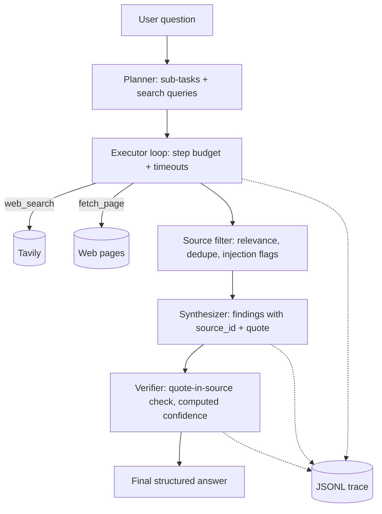

# Evidence-First Research Agent

A production-minded AI research agent. Given a research-style question, it **plans**, **chooses tools**, **gathers and filters sources**, and returns a **schema-validated answer in which every finding is backed by a quote that our code verifies against the fetched source text**. Confidence is computed from evidence signals, not self-reported by the LLM.

> Built as a take-home assignment. The goal is sound engineering judgment on a small, focused system, not a large platform.

## Contents
1. [Quick start](#quick-start)
2. [What it does](#what-it-does)
3. [Architecture](#architecture)
4. [README questions](#answers-to-the-assignment-questions)
5. [Evaluation](#evaluation)
6. [Known limitations](#known-limitations)
7. [Future improvements](#future-improvements)

## Quick start

**Requirements:** Python 3.11+ and API keys for an LLM provider (Groq; Gemini optional) and Tavily (search).

```bash
git clone https://github.com/<your-username>/evidence-first-research-agent.git
cd evidence-first-research-agent
python -m venv .venv
# Windows PowerShell: .venv\Scripts\Activate.ps1   |   Mac/Linux: source .venv/bin/activate
pip install -r requirements.txt
cp .env.example .env     # Windows: copy .env.example .env  -> then add your keys
python scripts/check_setup.py   # verifies keys, LLM and search connectivity
```

**Run (CLI):**
```bash
python -m app.cli "Compare the top 3 open-source vector databases for a startup building RAG products"
```
<!-- TODO(phase 6): confirm exact command and add API usage (uvicorn app.main:app, POST /research) -->

Every run writes a trace to `traces/<run_id>.jsonl`.

## What it does

Input: a question. Output (JSON, validated by Pydantic):

| Field | Meaning |
|---|---|
| `question` | The user question |
| `short_answer` | 2-4 sentence answer |
| `key_findings` | Claims, each with `source_id`, a verbatim `quote`, and a `verified` flag set by our code |
| `sources` | Sources actually used, with domain, relevance score and flags |
| `confidence` | `high` / `medium` / `low`, computed from evidence signals |
| `confidence_reasons` | Why that level was assigned |
| `limitations` | Assumptions and gaps |
| `next_steps` | Suggested follow-ups |

## Architecture



**Components** (all in `app/`):
- `planner.py`: turns the question into a bounded plan (max 4 sub-tasks).
- `executor.py`: runs the plan with the tools under a step budget and per-call timeouts.
- `tools/search.py`, `tools/fetch.py`: the two tools (below).
- `filtering.py`: scores and dedupes sources, drops weak ones, flags suspicious content.
- `synthesizer.py`: asks the LLM for a draft answer constrained to the provided sources.
- `verifier.py`: checks quotes against source text and computes confidence.
- `llm.py`: provider wrapper with timeouts, bounded retries and structured-output parsing.
- `schemas.py`: all data shapes, defined once.
- `tracing.py`: one JSONL line per event.

**Stack:** Python, FastAPI, Pydantic v2, OpenAI-compatible SDK (Groq `openai/gpt-oss-120b`), Tavily search, `trafilatura` for page text extraction. No agent framework, on purpose, so the control flow is readable in about 300 lines.

## Answers to the assignment questions

### Why did you choose an agentic approach here?
Research questions need **dynamic retrieval**: the number of searches and which pages to read depends on what earlier steps return, and a weak first search should trigger a refined one. A single prompt cannot do that. At the same time, the workflow is **bounded and mostly deterministic**: plan, gather, filter, synthesize, verify. So the agent only decides *what to search/fetch next*; everything else is fixed code. That limits cost and failure modes. <!-- TODO(phase 7): link the baseline comparison showing where the agent helped and where it did not -->

### What tools did you use, and why?
- **`web_search`** (Tavily): finds candidate sources and returns titles, URLs and snippets.
- **`fetch_page`**: downloads a page and extracts clean text. Snippets alone are too shallow to verify claims against, so evidence is read from the full text.

The executor chooses between them per sub-task (e.g. search first, then fetch only the top candidates). <!-- TODO(phase 3): describe the actual selection logic once implemented -->

### How does the system handle bad tool results?
- **Timeouts and bounded retries** with backoff on every network call; a hung call cannot hang a run.
- **Schema validation** of tool output; malformed output is logged and skipped, not trusted.
- **Fallbacks:** a failed fetch moves on to the next source; a failed search retries with a reworded query.
- **Graceful degradation:** if too little evidence survives filtering, the system returns a `low` confidence answer that says so, rather than guessing.
- **Step and cost budget** caps total tool calls per run.
<!-- TODO(phase 5): confirm each item is actually implemented; remove any that are not -->

### How do you reduce hallucinations?
1. The synthesizer sees **only** the filtered sources, labelled `S1..Sn`.
2. Every finding must carry a `source_id` and a **verbatim quote**.
3. **Our code, not the LLM,** checks that the quote appears in that source's text. Unverified findings are dropped or flagged.
4. Confidence is **computed** from signals (verified-quote ratio, number of independent domains, source agreement). The LLM never rates its own confidence.
5. Low confidence triggers an explicit "insufficient evidence" answer.
<!-- TODO(phase 5): add measured citation-validity rate from the eval -->

### Prompt-injection awareness
Fetched web content is untrusted. It is passed to the LLM inside delimited data blocks with instructions never to follow commands found in content, and our tool layer flags injection-like patterns on the source. Tools are **read-only** (no email, no writes, no code execution), so the blast radius of a successful injection is limited to a degraded answer. A deliberate injection test is part of the eval. <!-- TODO(phase 5/7): report test result honestly -->

### How would you make this production-ready?
- Async tool execution and parallel fetches; a real queue and worker for long runs.
- Caching of search and fetch results; rate limiting per user.
- Provider fallback and circuit breakers; secrets management; auth on the API.
- Domain allow/deny lists and a stronger injection classifier.
- Persisted traces in an observability stack (Langfuse or OpenTelemetry) instead of local JSONL files.
- A regression eval suite in CI that runs on every prompt or model change.
- Dockerized deployment on Linux/cloud with health checks.

### What would you monitor in production?
Latency per stage and end to end; tool error and timeout rates; **citation verification rate**; share of `low`-confidence answers; tokens and cost per run; step-budget exhaustion rate; injection-flag rate; provider error and rate-limit rate; user feedback on answer quality.

### What were your key tradeoffs?
| Decision | Chose | Gave up |
|---|---|---|
| Orchestration | Small custom loop | Framework features (retries, graphs) for readability |
| Execution | Synchronous | Speed from parallel fetches |
| Confidence | Computed from evidence | Nuance an LLM judge might capture |
| Verification | Exact quote match | Misses valid paraphrases (tradeoff: false negatives over hallucinations) |
| Scope | One agent, two tools | Breadth (no memory, no multi-agent) |
| Provider | Groq free tier | Possible rate limits |
<!-- TODO: add anything we actually hit while building -->

## Evaluation
See [`eval/EVALUATION.md`](eval/EVALUATION.md). <!-- TODO(phase 7) -->

Summary table (agent vs single-shot LLM baseline): <!-- TODO: fill with measured numbers only -->

| Metric | Baseline | Agent |
|---|---|---|
| Citation validity | TODO | TODO |
| Avg sources used | TODO | TODO |
| Latency (s) | TODO | TODO |

Sample outputs: [`samples/`](samples/). <!-- TODO(phase 9) -->

## Known limitations
<!-- TODO(phase 9): write from what actually broke. Draft candidates: -->
- Exact-quote verification rejects correct paraphrases and fails on pages whose text extraction is lossy.
- Search quality depends on Tavily; niche topics may return thin results.
- Free-tier LLM rate limits can slow or fail runs.
- Paywalled or JS-rendered pages cannot be fetched.
- No conversation memory; each question is independent.

## Future improvements
- Async/parallel tool calls and caching.
- LLM-judge evaluator step and a larger regression suite.
- Semantic (not only exact) quote verification.
- Follow-up question memory.
- Observability integration (Langfuse/OpenTelemetry).
- Provider fallback chain (Gemini as secondary).